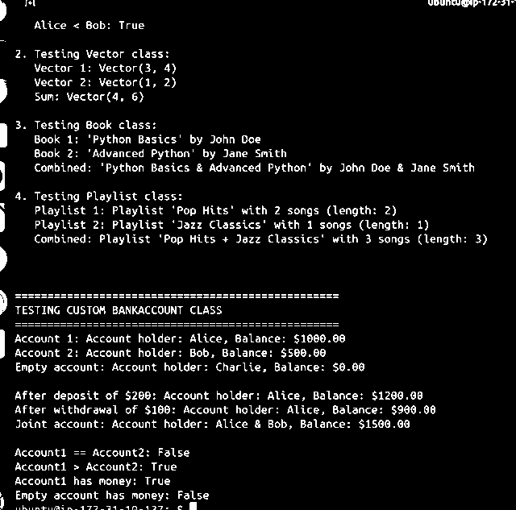

# Lab 43 - Magic Methods | Execution Proof

## Run command

```bash
python3 lab_43.py
```

## Actual terminal screenshot



## Results captured

- The terminal reports **"Lab completed successfully!"**
- `__str__` and `__repr__` provide readable object output.
- `__add__` supports custom addition for vectors, books, playlists, and bank accounts.
- Comparison methods and `__len__` are demonstrated.
- BankAccount examples show deposits, withdrawals, joint balances, and Boolean checks.
